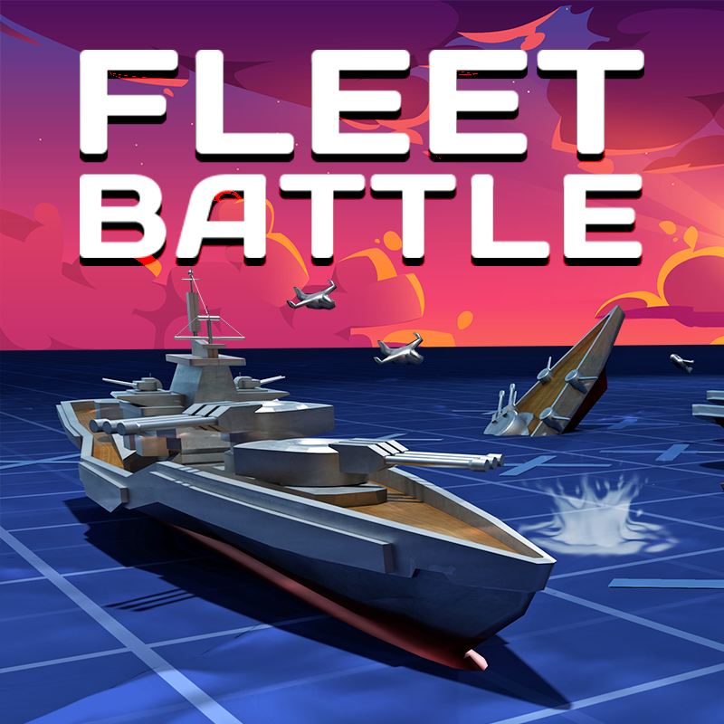

# Hundir la Flota | Battleship

## Descripción del proyecto

Desarrollo del clásico juego **Hundir la Flota** utilizando Python y NumPy.

El juego consiste en enfrentar a un jugador contra la máquina mediante un sistema de turnos. Cada participante dispone de una flota de barcos colocados aleatoriamente en un tablero de 10x10.

El objetivo es localizar y hundir todos los barcos del adversario antes de que este consiga hundir los propios.

Este proyecto forma parte del **Bootcamp de Data Science** y permite aplicar conocimientos de programación en Python, manipulación de arrays y programación orientada a objetos.

**Estado del proyecto:** En desarrollo y fase de pruebas.

---

## Objetivos

- Crear y gestionar tableros mediante arrays de NumPy.
- Generar barcos de diferentes tamaños.
- Colocar barcos aleatoriamente en el tablero.
- Implementar un sistema de disparos mediante coordenadas.
- Diferenciar los disparos acertados de los fallidos.
- Gestionar los turnos entre el jugador y la máquina.
- Permitir repetir turno después de un acierto.
- Detectar cuándo una flota ha sido hundida.
- Aplicar programación orientada a objetos (POO).

---

## Tecnologías utilizadas

- **Python 3:** lenguaje principal de programación.
- **NumPy:** creación y manipulación de tableros.
- **Random:** generación de posiciones y disparos aleatorios.
- **Git y GitHub:** control de versiones y almacenamiento del proyecto.
- **VS Code:** entorno de desarrollo.

---

## Funcionamiento del juego

### 1. Creación de tableros

Cada participante dispone de dos tableros de 10x10:

- `tablero_barcos`: contiene las posiciones de sus barcos.
- `tablero_disparo`: registra los disparos realizados contra el adversario.

Los tableros se generan utilizando arrays de NumPy.

### 2. Composición de la flota

Cada jugador dispone de **6 barcos**, que ocupan un total de **16 casillas**.

| Cantidad | Tamaño del barco | Casillas ocupadas |
|----------|------------------|-------------------|
| 3 | 2 posiciones | 6 |
| 2 | 3 posiciones | 6 |
| 1 | 4 posiciones | 4 |
| **Total: 6 barcos** | | **16 casillas** |

Los barcos se colocan automáticamente en posiciones aleatorias dentro del tablero.

### 3. Sistema de disparos

El jugador introduce las coordenadas de la casilla a la que desea disparar.

La máquina realiza disparos utilizando coordenadas generadas aleatoriamente.

El programa comprueba el contenido de la posición seleccionada y determina si el disparo ha alcanzado un barco o ha caído al agua.

### 4. Representación del tablero

Se utilizan diferentes símbolos para representar el estado de las casillas.

| Símbolo | Significado |
|---------|-------------|
| ` ` | Casilla vacía / agua |
| `O` | Posición de un barco |
| `X` | Barco alcanzado |
| `-` | Disparo al agua |

### 5. Sistema de turnos

El juego alterna entre el jugador y la máquina.

- Si el disparo alcanza un barco, el participante conserva su turno.
- Si el disparo cae al agua, el turno pasa al adversario.
- Los tableros se actualizan después de cada disparo.
- La partida continúa hasta que uno de los participantes consigue hundir toda la flota contraria.

### 6. Condición de victoria

La partida termina cuando uno de los participantes consigue alcanzar las 16 posiciones ocupadas por los barcos del adversario.

---

## Estructura del código

El proyecto se organiza mediante funciones y una clase principal.

### Funciones

| Función | Descripción |
|---------|-------------|
| `crear_tablero()` | Genera un tablero de 10x10 utilizando NumPy. |
| `colocar_barco()` | Coloca un barco en las coordenadas indicadas. |
| `crea_barco_aleatorio()` | Genera las coordenadas de un barco aleatorio. |
| `coloca_solo()` | Gestiona la colocación automática de barcos. |
| `flota()` | Genera la flota completa de cada participante. |
| `recibir_disparo()` | Comprueba si un disparo alcanza un barco o cae al agua. |
| `jugar()` | Controla los turnos y el desarrollo de la partida. |

### Clase `Jugador`

La clase `Jugador` representa a los participantes de la partida.

Cada objeto dispone de:

- Un tablero con sus barcos.
- Un tablero para registrar los disparos.
- Un método `disparar()` para realizar ataques.

Esta estructura permite aplicar conceptos de **programación orientada a objetos (POO)**.

---

## Conceptos de Python aplicados

Durante el desarrollo del proyecto se trabajan los siguientes conceptos:

- **Funciones:** organización del código en bloques reutilizables.
- **Clases y objetos:** representación de los jugadores.
- **Atributos y métodos:** gestión de las características y acciones de cada jugador.
- **Arrays de NumPy:** creación y manipulación de matrices.
- **Bucles `while`:** repetición de turnos hasta cumplir una condición.
- **Bucles `for`:** iteración sobre elementos y posiciones.
- **Condicionales `if`, `elif` y `else`:** evaluación de disparos y condiciones.
- **Indexación:** acceso a posiciones específicas de los tableros.
- **Operadores lógicos:** comprobación de condiciones.
- **Random:** generación de coordenadas aleatorias.
- **Método `.any()`:** comprobación de barcos pendientes en el tablero.

---

## Instalación y ejecución

### Requisitos

- Python 3
- NumPy

### Instalación de dependencias

Desde la terminal:

```bash
python3 -m pip install numpy
```

### Ejecución del programa

1. Descargar o clonar el repositorio.
2. Abrir el proyecto en VS Code.
3. Comprobar que las dependencias están instaladas.
4. Ejecutar el archivo principal desde la terminal:

```bash
python3 ejercicio.py
```

**Nota:** La ejecución completa de la partida está pendiente de verificación en la versión actual del proyecto.

---

## Estado del proyecto

### Funcionalidades desarrolladas

- [x] Creación de tableros de 10x10.
- [x] Creación de la clase `Jugador`.
- [x] Definición de la flota de 6 barcos.
- [x] Generación de coordenadas aleatorias.
- [x] Lógica de colocación de barcos.
- [x] Sistema de disparos.
- [x] Identificación de aciertos y fallos.
- [x] Actualización de las posiciones del tablero.
- [x] Lógica de turnos entre jugador y máquina.
- [x] Condición para detectar la victoria.

### Pendiente de revisión

- [ ] Verificar la inicialización de los jugadores y sus tableros.
- [ ] Evitar que la máquina repita disparos.
- [ ] Validar las coordenadas introducidas por el usuario.
- [ ] Comprobar que los barcos no se superponen.
- [ ] Revisar las condiciones de victoria.
- [ ] Realizar pruebas completas de funcionamiento.
- [ ] Mejorar la visualización de los tableros.

---

## Posibles mejoras futuras

- Implementar un contador de disparos.
- Incorporar estadísticas de las partidas.
- Añadir diferentes niveles de dificultad.
- Mejorar la estrategia de disparos de la máquina.
- Desarrollar una interfaz gráfica.
- Permitir configurar el tamaño del tablero y la composición de la flota.

---

## Contexto académico

Proyecto desarrollado durante el **Bootcamp de Data Science**.

Su finalidad es consolidar los conocimientos de programación en Python, manipulación de arrays con NumPy y programación orientada a objetos mediante el desarrollo de un juego interactivo.

El proyecto se encuentra en proceso de desarrollo, revisión y mejora.
